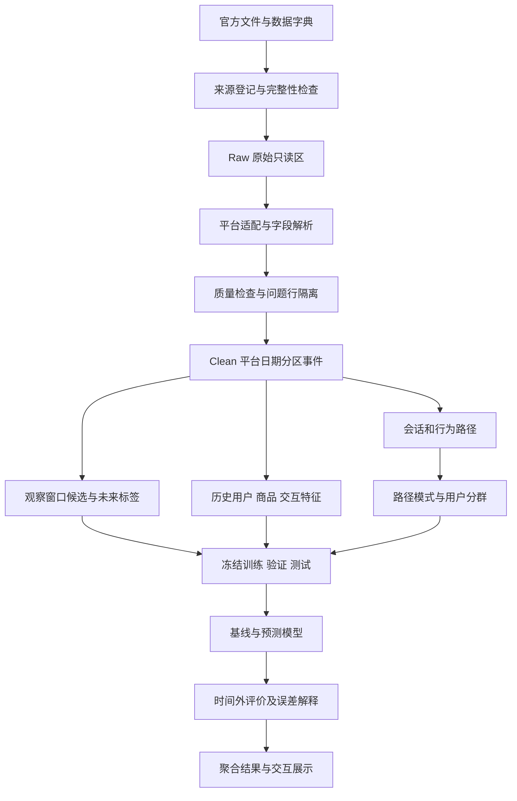

# 电商用户行为路径挖掘与购买转化预测：毕业设计详细计划书

> 编制日期：2026年10月22日。适用专业：数据科学与大数据应用／数据科学与大数据技术。计划周期：12周，按本科个人项目设计。
>
> 已确认条件：目前没有自有京东、拼多多用户行为日志，按公开数据可获得范围规划。
>
> 文档性质：研究与实施计划。本文中的数据规模、参数、质量门槛、软件接口、界面和实验均为拟实施内容；尚未完成原始数据下载、清洗、建模或效果验证。示例记录与业务情境均为说明口径而构造，不是实验结果。

## 阅读目录

- [1. 首先确定使用哪些技术](#1-首先确定使用哪些技术)
- [2. 项目定位、题名和服务对象](#2-项目定位题名和服务对象)
- [3. 各电商平台分别怎样分析](#3-各电商平台分别怎样分析)
- [4. 数据如何获得，以及多源数据怎样使用](#4-数据如何获得以及多源数据怎样使用)
- [5. 将研究问题写成可计算的任务](#5-将研究问题写成可计算的任务)
- [6. 总体数据流程与存储设计](#6-总体数据流程与存储设计)
- [7. 数据清洗如何逐步实施](#7-数据清洗如何逐步实施)
- [8. 基础统计与购买转化口径](#8-基础统计与购买转化口径)
- [9. 会话、路径与序列数据怎样构建](#9-会话路径与序列数据怎样构建)
- [10. 数据挖掘如何具体实施](#10-数据挖掘如何具体实施)
- [11. 预测特征如何构建](#11-预测特征如何构建)
- [12. 时间切分、样本构建与信息泄漏控制](#12-时间切分样本构建与信息泄漏控制)
- [13. 模型选择、训练和解释](#13-模型选择训练和解释)
- [14. 怎样评价数据挖掘和预测结果](#14-怎样评价数据挖掘和预测结果)
- [15. 实验设计清单](#15-实验设计清单)
- [16. 大数据处理与性能实验怎样落实](#16-大数据处理与性能实验怎样落实)
- [17. 成果展示需要实现哪些功能](#17-成果展示需要实现哪些功能)
- [18. 模块接口与实现顺序](#18-模块接口与实现顺序)
- [19. 关键验证与手工验算](#19-关键验证与手工验算)
- [20. 十二周实施安排](#20-十二周实施安排)
- [21. 每个阶段需要交付什么](#21-每个阶段需要交付什么)
- [22. 毕业论文建议结构](#22-毕业论文建议结构)
- [23. 风险、应对与范围控制](#23-风险应对与范围控制)
- [24. 最终验收清单](#24-最终验收清单)
- [25. 本次调研依据与参考入口](#25-本次调研依据与参考入口)
- [附录A：配置文件设计示例](#附录a配置文件设计示例)
- [附录B：手工验算样例](#附录b手工验算样例)
- [附录C：建议保存的结果表模板](#附录c建议保存的结果表模板)
- [附录D：答辩时需要能回答的问题](#附录d答辩时需要能回答的问题)

## 1. 首先确定使用哪些技术

本节先列技术及其职责，后续章节逐项展开数据怎样获得、怎样清洗、怎样挖掘以及怎样验证。

### 1.1 必需技术清单

| 技术点 | 解决的问题 | 在本项目中的具体用途 | 必须产出的证据 |
| --- | --- | --- | --- |
| Python | 串联数据任务和实验 | 配置加载、采集清单、任务调度、结果导出 | 可重复执行的脚本与运行日志 |
| PySpark／Spark SQL | 原始日志体量较大，难以全部载入 pandas | CSV读取、列校验、平台行为映射、关联、聚合、窗口计算 | 实际行数、作业日志、运行耗时、执行计划 |
| Parquet | 原始CSV重复扫描成本较高 | 保存清洗事件、候选样本、特征及结果，按平台和日期分区 | 分区目录、字段模式、文件大小 |
| 显式数据模式与数据契约 | 不同平台字段和行为定义不同 | 固定字段、类型、时区、事件映射与版本 | 数据字典、校验报告、映射表 |
| 数据质量规则 | 缺失、异常、重复导入和时间错误影响结论 | 分级处理问题行，保留原因与处理去向 | 质量报告、隔离表、行数对账 |
| 时间窗口与会话切分 | 用户意向随近期行为变化 | 过去24／48小时统计、30分钟间隔会话、未来24小时标签 | 窗口定义、边界案例、样本表 |
| 有序漏斗与转移分析 | 识别行为阶段和常见去向 | 浏览到加购、收藏到购买等时序统计 | 有序漏斗、转移矩阵、分母说明 |
| PrefixSpan | 挖掘保留先后顺序的高频行为模式 | 发现浏览、加购、回访等常见序列 | 模式、支持度、覆盖样本数 |
| K-means与标准化 | 识别不同活跃和行为意向模式 | 用户行为分群及群体画像 | 群体特征、规模、稳定性与轮廓系数 |
| 逻辑回归 | 建立可解释的预测基线 | 预测用户—商品对未来24小时是否出现目标事件 | 系数、预测概率、时间外测试结果 |
| Spark GBTClassifier | 学习非线性行为组合 | 比较行为次数、近期性、路径特征的作用 | 模型、参数、特征重要性、预测结果 |
| 时间回测与消融实验 | 防止未来信息泄漏，验证路径特征价值 | 按日期训练、验证、测试，比较逐步增加特征的模型 | 冻结切分清单、指标表、误差分析 |
| AP／PR-AUC、Top-K与概率评价 | 正样本稀少，准确率容易误导 | 按各自定义比较平均精确率、召回、排序与概率偏差 | 自然分布测试集指标及计算口径 |
| DuckDB或等价本地查询工具 | 展示端需要快速读取聚合结果 | 查询画像、路径汇总、预测清单、评价表 | 可复查的查询与结果文件 |
| Streamlit＋Plotly | 让研究成果可操作、可解释 | 平台切换、质量报告、路径分析、画像、购买意向排序与实验对比 | 可运行展示与功能验收记录 |
| Git＋配置文件＋数据清单 | 保存代码、参数与数据来源 | 版本控制、实验标识、文件哈希、结果追踪 | 代码版本、配置快照、数据清单 |

### 1.2 可选技术及启用条件

| 可选技术 | 适用情况 | 启用条件 |
| --- | --- | --- |
| FP-Growth | 研究同一会话内行为或类目的共现组合 | 与序列研究分开解释；不把无序项集当作行为路径 |
| LightGBM／XGBoost | 聚合后的训练特征能被本机安全承载时，补充模型比较 | 记录载入内存的实际规模；与Spark模型保持同一切分和评价口径 |
| SHAP或排列重要性 | 解释树模型和代表性样本 | 在固定评价子集执行，报告抽样方法与成本 |
| 官方开放平台API | 后续获得合法账号、权限及可关联数据 | 明确字段、授权范围和事件语义；不得假设可取得完整消费者行为 |
| HDFS／多机Spark | 学校提供真实集群时验证跨节点处理 | 必须记录节点、配置和相同任务下的实测；单机不能报告集群加速结论 |
| 工作流工具 | 作业数量增加后管理任务依赖 | 核心脚本已可独立运行，再考虑增加调度组件 |

基础方案使用离线日志批处理。Kafka、Flink、复杂微服务和深度序列网络不列为必需项。核心工作量优先投入数据治理、路径挖掘和严谨实验。

### 1.3 软件与资源建议

- 计划兼容组合：Python 3.11、Java 17、PySpark 3.5.x，配套选择相容的 scikit-learn、DuckDB、Streamlit、Plotly 版本。首次验证后冻结精确依赖版本。
- 推荐机器：8核CPU、16GB内存、至少150GB可用磁盘；实际需求由样本试运行测量，磁盘估计包含原始文件、Parquet、临时Shuffle和中间产物。
- 普通机器起步：4核CPU、8GB内存，先处理按用户抽取的完整历史子集，再决定全量作业安排。
- 16GB单机的起始配置可设为 `local[4]`、Driver 6GB、Shuffle分区64；这是调优起点，不是性能承诺。
- 同一时间只运行一个重型清洗或训练任务，展示端读取预计算结果。每次扩量前确认磁盘和内存余量。

## 2. 项目定位、题名和服务对象

### 2.1 题名与范围

当前最稳妥的正式题名：

**《淘宝用户行为路径挖掘与商品购买转化预测研究》**

若第一阶段取得并验收京东原始数据，可采用双平台题名：

**《淘宝与京东用户行为路径挖掘及短期购买意向预测研究》**

“短期购买意向”在实验中必须落实为明确的可观测事件：淘宝的购买记录、京东的下单记录分别预测、分别解释。双平台版本研究同一方法在不同数据集中的表现，不把两种事件直接等同于付款成功。

本计划对淘宝、京东、拼多多分别编写方案。淘宝为主实验；京东为取得数据后的独立对照；拼多多为取得真实日志后的扩展。题名与论文结论以实际完成的数据范围为准。

### 2.2 数据中的人，与使用成果的人

| 层面 | 具体对象 | 能够支持的工作 |
| --- | --- | --- |
| 研究对象 | 公开数据中的匿名电商消费者 | 观察其浏览、收藏、加购、购买／下单记录及时间关系 |
| 主要使用者 | 平台用户增长、商品运营、数据分析人员 | 发现高频路径、比较群体、查看候选用户—商品对及其预测分数 |
| 学术使用者 | 毕设研究者、导师、评审 | 检查来源、数据质量、定义、算法、评价和复现材料 |
| 可参考者 | 商家运营人员 | 参考行为规律和分析方法；只有获得店铺归属及真实业务数据后，才能开展店铺级研究 |

UserBehavior不含店铺归属、订单金额、利润、营销触达、真实支付和退款明细，因此基础版本的成果面向平台匿名行为分析，不能输出真实店铺ROI、客单价或营销收益。

### 2.3 实际业务场景

情境一：某用户最近两天反复浏览同一商品，并出现加购和回访。分析人员需要知道这一行为模式是否在历史数据中伴随更高的次日购买比例。

情境二：某类商品浏览量较高，但浏览后的加购、购买记录比例较低。分析人员希望定位发生变化的时段和行为路径，而不是凭图表直接归因为价格或页面质量。

情境三：相同的路径特征构建方法在淘宝和京东分别建模后，效果是否稳定，哪些差异可能来自行为定义、类目范围、采样方式或时间跨度。

这些场景的交付是离线分析、候选排序和实验报告。线上优惠券投放、营销触达与真实转化提升需要另行授权和线上实验。

### 2.4 核心研究问题

1. 在各平台内部，常见的浏览、收藏、加购、购买／下单路径是什么？
2. 哪些历史行为前缀与未来24小时目标事件存在较强统计关联？
3. 行为频次、近期性和用户分群分别能解释哪些差异？
4. 在相同模型和切分下，加入路径特征是否改善预测？
5. 方法在第二个平台独立应用时，哪些结论能够重复，哪些受到数据口径影响？

## 3. 各电商平台分别怎样分析

### 3.1 平台范围与可用性状态

| 平台 | 当前依据 | 计划地位 | 第一阶段需要满足的条件 |
| --- | --- | --- | --- |
| 淘宝 | 已知天池UserBehavior公开数据入口，已核查相关GitHub字段说明 | 必做主线 | 取得原始文件、原始字典与许可说明，验证字段、时间范围、文件完整性 |
| 京东 | 已核查JData高潜用户购买意向预测的公开代码、文件名和行为映射 | 独立对照 | 取得有来源说明的对应版本原始数据和字典；旧竞赛代码可读不代表数据仍可下载 |
| 拼多多 | 本次尚未核实可公开取得的同等级消费者行为日志 | 条件扩展 | 获得公开可用或明确授权的数据，确认完整行为、时间和目标事件语义 |

当前三平台原始日志均未在本任务中下载、验收或统计。若京东在第一阶段无法取得合格数据，基础毕业设计按淘宝单平台完成；京东保留为已设计的迁移方案，不能写成已完成实验。拼多多同理。

### 3.2 淘宝分析方案

**候选来源**：阿里天池 UserBehavior 数据集，入口 `https://tianchi.aliyun.com/dataset/649`。

常见原始文件为无表头的 `UserBehavior.csv`，预期五列：

| 字段 | 计划类型 | 含义 | 使用限制 |
| --- | --- | --- | --- |
| user_id | STRING | 匿名用户标识 | 只在淘宝数据内部关联，不当作连续数值特征 |
| item_id | STRING | 匿名商品标识 | 不假设与当前线上商品编号一致 |
| category_id | STRING | 匿名商品类目标识 | 缺少官方映射时显示编码，不自行命名为美妆、数码等 |
| behavior_type | STRING | pv、fav、cart、buy | 映射前保留原值，按字典核验 |
| timestamp | LONG | Unix秒级时间戳 | 按UTC时刻解释，再按Asia/Shanghai生成业务日期 |

通常介绍的时间范围为2017年11月25日至12月3日，规模约1亿条行为。以上是数据集描述与计划依据，实际边界和行数必须重新统计确认。

淘宝分别输出：

- 每日行为量、活跃用户、活跃商品与类目分布。
- 浏览、收藏、加购、购买的事件组成及有序关系。
- 用户—商品级的回访、加购后回访、收藏后购买等路径。
- 基于活跃度、近期性、商品广度和历史意向行为的用户分群。
- 在近期交互过的商品范围内，预测用户未来24小时是否产生购买记录。

数据仅覆盖短期，不安排月度留存、生命周期价值、长期流失或长期复购结论。

### 3.3 京东分析方案

**候选版本**：JData高潜用户购买意向预测历史竞赛数据，必须固定具体年份和版本，避免混用其他JData竞赛。

公开代码中可核查到以下文件名：

- `JData_Action_201602.csv`
- `JData_Action_201603.csv`
- `JData_Action_201603_extra.csv`
- `JData_Action_201604.csv`
- `JData_User.csv`／相应版本用户表
- `JData_Product.csv`
- `JData_Comment.csv`

这些文件名只证明相关版本被公开代码引用。特别是 `extra` 文件是否与其他文件重叠，必须查对应版本说明；不能全部直接拼接。

预期行为表包含 `user_id、sku_id、time、type`，部分版本还有 `model_id、cate、brand`。用户表可能包含年龄区间、性别、会员等级、注册时间；商品表可能包含类目、品牌、匿名属性；评论表可能是按日期更新的统计快照。实际字段以原始文件和字典为准。

公开代码中的行为编码初步对应为：

| 京东原始type | 初步含义 | 通用分析映射 | 平台特有信息保留 |
| --- | --- | --- | --- |
| 1 | 浏览 | browse | 保留原type |
| 2 | 加购 | cart_add | 保留原type |
| 3 | 删除购物车商品 | cart_remove | 用于意向回撤、加购后删除路径 |
| 4 | 下单 | order | 作为京东目标事件；不改写为支付 |
| 5 | 关注 | favorite | 保留“关注”原始语义 |
| 6 | 点击 | click | 与浏览分别保留；是否合并需有版本字典依据 |

京东独立开展：

1. 校验浏览与点击区别，以及加购、删购、关注、下单口径。
2. 对行为表与用户、商品、评论统计做有依据的关联。
3. 研究加购后删除、删除后回访等淘宝基础数据未记录的路径。
4. 在用户—商品对上预测未来24小时下单；与淘宝共享方法，但各自训练模型。
5. 评论统计按 `snapshot_date <= prediction_time` 做最近历史快照关联，避免引入未来评价信息。
6. 若数据版本限定某类商品，明确候选商品范围，不扩写为京东全站结论。

### 3.4 拼多多分析方案

拼多多目前不具备与淘宝、京东同等级的已核实日志来源。商品展示、评论和公开榜单可以用于商品内容分析，但不能据此还原匿名消费者的浏览—加购—购买路径。

只有取得真实可用日志后，才启用以下流程：

1. 登记来源、权限、采集日期、覆盖范围和脱敏方式。
2. 核实用户、商品、事件类型、时间戳及下单／支付字段。
3. 若数据确实含分享、参团、成团等事件，再增加拼团相关路径；仅因平台存在该功能，不能假定数据也包含对应日志。
4. 明确目标事件是下单、成团还是支付，选择其中一个作为主目标。
5. 独立训练和评价，再比较共同可观测行为下的方法表现。

若需要展示适配过程，可使用明确标记的人工演示事件测试字段映射。演示数据只验证软件流程，不参与真实业务结论、规模统计或模型效果比较。没有日志时，展示为“尚未接入可用行为数据”，不展示零转化率或虚构报表。

### 3.5 多平台分析的共同规则

- 用户键使用 `(platform, user_id)`，商品键使用 `(platform, item_id)`；相同数字在不同平台不代表同一实体。
- 每个平台独立生成时间窗口、样本、画像、路径字典和模型。
- 保留原始事件类型，同时提供可比较的粗粒度行为映射。
- 平台之间只比较定义一致的统计，且同时列出样本范围、时间、类目、目标事件和采样差异。
- 历史淘宝与历史京东数据的年份和活动背景不同，不能凭离线指标判断哪家平台经营更好。
- 在取得可信跨平台映射前，不研究“同一用户从淘宝流向京东”或相同商品的跨平台转化。

## 4. 数据如何获得，以及多源数据怎样使用

### 4.1 公开文件的取得流程

1. 从官方数据页查看说明、下载要求和使用条件，保存说明文件的本地副本及取得日期。
2. 如需账号，由使用者在官方页面完成登录和下载；不在脚本中嵌入账号、密码或Cookie。
3. 将下载包放入项目外部的数据目录，先检查文件大小、归档目录与压缩完整性。
4. 记录SHA-256用于本项目版本识别；如果官方公布校验值，再与其比对。自行计算哈希只能识别版本，不能独立证明来源真实。
5. 解压到只读原始区，抽取少量记录检查编码、分隔符、表头、列数和时间单位。
6. 以文件清单控制导入，已经导入且内容相同的文件不重复进入统计。
7. 官方入口不可用时，先寻找有来源链和版本说明的合法镜像或存档。只提供清洗后序列、缺少行为类型和时间的文件，不能代替本项目原始日志。

### 4.2 多源数据的层次

| 层次 | 主体 | 获取方式 | 关联方式 | 用途 |
| --- | --- | --- | --- | --- |
| 行为日志 | 淘宝／京东消费者事件 | 官方文件批量下载 | 平台内部用户、商品和时间 | 路径、画像、标签、预测 |
| 用户属性 | 京东对应版本匿名用户表 | 同版本文件下载 | 平台＋用户ID | 作为可选背景特征，检查缺失与异常 |
| 商品属性 | 京东对应版本商品表 | 同版本文件下载 | 平台＋商品ID | 类目、品牌和匿名属性关联 |
| 评论统计 | 京东对应版本历史快照 | 同版本文件下载 | 商品ID＋不晚于预测时刻的日期 | 历史商品背景；不可替代消费者行为日志 |
| 日历信息 | 日期、小时、周几 | 从业务时间计算 | 平台业务日期 | 时段分析和日历特征 |
| 后续授权日志 | 拼多多或真实商家范围 | 经授权API或日志导出 | 经核验的平台实体键 | 独立扩展实验 |

淘宝匿名商品ID没有经过验证的线上映射时，不使用当前商品网页补充价格、评论或销量。多源融合必须建立在能验证的实体关联上。

### 4.3 数据登记清单

每个输入文件至少登记：`source_id、platform、dataset_version、source_url、retrieved_at、filename、sha256、bytes、encoding、header、schema_version、declared_start、declared_end、permission_note、ingest_status`。

首次完成解析后补充：实际总行数、最早和最晚时间、按日记录量、事件类型集合、用户和商品数量、问题行数。描述文件注明统计来自全量还是抽样。

### 4.4 当前调研的访问限制

本次能读取相关GitHub仓库及关键代码；访问天池和DataFountain官方数据页时，当前云环境返回代理403。因而本计划确认的是公开资料、字段依据与实施路线，尚未确认完整原始数据在本环境可下载。

如果继续在当前环境实施，应先解决官方数据域名访问或把合法下载文件放入数据目录，再执行样本验收。不能把访问失败写成“平台没有公开过数据”，也不能把GitHub仓库可访问写成“原始数据已经取得”。

## 5. 将研究问题写成可计算的任务

### 5.1 主预测任务

样本单位：**平台内的用户—商品—预测时点**，即 `(platform, user_id, item_id, t)`。

默认特征观察窗口为过去48小时，标签窗口为未来24小时：

```text
观察窗口：[t - 48小时, t)
候选集合：观察窗口内至少有一次非目标意向行为的用户—商品对
淘宝候选行为：pv、fav、cart
京东候选行为：经字典确认后的browse、click、cart_add、cart_remove、favorite

淘宝标签：在 [t, t + 24小时) 内是否出现同一用户对同一商品的buy
京东标签：在 [t, t + 24小时) 内是否出现同一用户对同一商品的order
```

使用左闭右开区间。发生在`t`的事件只能用于标签或后续时间的特征，不能用于本次历史特征。

定义：

\[
y_{u,i,t}=\mathbb{1}\{\text{用户 }u\text{ 在 }[t,t+24h)\text{ 对商品 }i\text{ 出现目标事件}\}
\]

标签窗口完整且数据覆盖通过验收时，没有观察到目标事件的候选对记为0。数据缺日、日志中断或窗口越过原始数据结束边界的样本不产生确定负标签。

同一用户对其他商品的购买不能把本商品标签改成1。同一商品一天内多次购买，二分类标签仍记为1，次数另行保存。

### 5.2 候选范围与结论边界

- 候选对只由`t`之前的行为生成，不能把未来购买商品补进候选集合。
- 任务回答的是“近期交互商品中的后续购买／下单”，不是所有商品的全库购买预测。
- 单独统计未来目标事件有多少落在候选集合内，形成候选覆盖率。该指标用于说明任务覆盖范围，不能反向改变候选生成规则。
- 原始窗口内已经购买过的用户—商品对可以保留，增加“此前是否出现购买”特征，并分别报告有、无历史购买两组表现。
- 因为历史观察期有限，“此前未观察到购买”不等于用户终身首次购买。
- `buy`或`order`不自动代表支付成功、未退款、成交金额或增量收益。

### 5.3 预测结果怎样用于展示

输出字段至少包括平台、预测时点、匿名用户、匿名商品、预测分数、模型版本、候选来源、关键历史特征和可解释说明。模型未经校准时，界面称“预测分数／估计概率”，不将其当作精确的真实成交概率。

运营展示可以按候选分数排序，但不执行自动营销触达。用户层面的意向汇总作为扩展；不能简单把多个商品概率相加或按独立事件公式合成为真实的“任意商品购买概率”。

## 6. 总体数据流程与存储设计



### 6.1 建议目录

```text
project/
  README.md
  configs/
    base.yaml
    taobao.yaml
    jd.yaml
    pdd.template.yaml
  src/
    acquisition/       # 数据清单和完整性检查
    adapters/          # 平台字段与行为适配
    quality/           # 校验、标记、隔离、对账
    features/          # 窗口、候选、标签和特征
    mining/            # 会话、路径、序列和分群
    modeling/          # 训练、预测和评价
    reporting/         # 聚合、图表、报告导出
  app/                 # 展示程序
  sql/                 # 可复查的查询
  tests/               # 数据边界与关键逻辑检查
  docs/                # 数据字典、口径、实验说明
  runs/<run_id>/        # 配置、指标、模型清单
  reports/             # 质量、路径、评价报告
  data_manifest/       # 来源与版本元数据

外部数据目录（不提交Git）：
  raw/<platform>/<dataset_version>/
  quarantine/<platform>/<run_id>/
  clean/platform=<p>/event_date=<d>/
  gold/<table>/platform=<p>/snapshot_date=<d>/
  models/<platform>/<model_version>/
```

### 6.2 主要数据表

| 表 | 粒度／主键 | 核心内容 |
| --- | --- | --- |
| source_manifest | 输入文件 | 来源、版本、哈希、编码、导入状态 |
| raw_event | 原始记录 | 原值、来源文件、可取得的行定位信息 |
| clean_event | 经校验的事件记录 | 平台、用户、商品、类目、标准行为、原行为、UTC时刻、业务日期、质量标记 |
| rejected_event | 问题记录 | 原值、主要拒绝原因、其他规则标记、处理版本 |
| item_dimension | 平台＋商品＋有效期 | 可信关联的类目、品牌等属性 |
| item_comment_snapshot | 平台＋商品＋快照日期 | 历史评论统计；仅京东有相应文件时生成 |
| session_event | 平台＋用户＋会话＋事件组 | 会话边界、时间组、同商品子序列 |
| path_pattern | 平台＋模式版本＋模式 | 支持度、次数、模式粒度、后续目标事件统计 |
| user_profile | 平台＋用户＋时点 | 过去窗口的活跃、广度、近期性、群体 |
| candidate_label | 平台＋用户＋商品＋t | 候选依据、目标标签、标签窗口完整性 |
| feature_table | 平台＋用户＋商品＋t | 历史特征、版本、最大源事件时间 |
| prediction | 平台＋用户＋商品＋t＋模型 | 分数、解释、模型版本 |
| evaluation | 平台＋切分＋模型＋指标 | 评价值、样本数、正例率、评价范围 |

每张结果表记录 `run_id、dataset_version、schema_version、feature_version` 等追踪字段或侧边元数据。高频用户ID、商品ID不作为目录分区，避免产生大量小文件。

## 7. 数据清洗如何逐步实施

### 7.1 清洗的基本原则

原始区只读，所有修正发生在新表；每条剔除规则有原因码，保留可追踪的问题记录；统计必须能对账。首先修复解析和定义问题，再开展行为分析。对高活跃用户、重复浏览和极端计数，先标记、解释，再决定是否做敏感性实验。

不能先观察测试集模型效果，再反向修改清洗阈值以提高成绩。固定规则可应用全量数据；需要从分布学习的阈值，只用训练历史拟合。

### 7.2 处理顺序与规则表

| 步骤 | 检查内容 | 检查方式 | 默认处理 | 需要保留的结果 |
| --- | --- | --- | --- | --- |
| 1 | 文件重复导入 | 来源版本、文件名、内容哈希和导入清单 | 跳过已成功导入的相同文件 | 跳过清单及对应原批次 |
| 2 | 压缩完整性 | 解压校验、归档文件列表 | 失败则停止该文件导入 | 文件错误报告 |
| 3 | 编码、表头和列数 | 抽样读取＋全量解析校验 | 淘宝按无表头五列；京东按版本显式设置 | 模式与坏行数量 |
| 4 | 用户／商品ID缺失 | 空串、空白、Null及字典规定非法值 | 隔离，不能生成有效交互或标签 | `MISSING_USER`／`MISSING_ITEM` |
| 5 | 时间不可解析 | 严格转换，统计失败值 | 隔离 | `INVALID_TIME`及原值 |
| 6 | 秒、毫秒混淆 | 位数、合理日期与字典联合判断 | 仅在确定整个来源单位错误时按版本修正 | 修正规则及前后样例 |
| 7 | 未知行为编码 | 与平台版本映射表关联 | 隔离或单列待确认，确认前不生成目标标签 | `UNKNOWN_ACTION` |
| 8 | 超出声明范围 | 实际时间与官方覆盖范围比较 | 先单列核查；明确为范围外记录后排除主实验 | `OUT_OF_SCOPE`与覆盖报告 |
| 9 | 类目缺失 | 非空和类型校验 | 保留有效事件，类目标记UNKNOWN；不编造真实类别 | 缺失率与UNKNOWN比例 |
| 10 | 商品属性关联失败 | 左关联，检查一对多和缺失 | 保留行为，属性缺失单独编码 | 匹配率和冲突列表 |
| 11 | 评论快照晚于t | As-of关联后检查时间 | 不使用未来快照，无历史快照则缺失 | 快照年龄与缺失标记 |
| 12 | 完全相同的行为行 | 对平台、用户、商品、行为、时间等分组计数 | 缺少事件ID时先保留并标记 | 重复组数、涉及记录数 |
| 13 | 高频和疑似自动化行为 | 训练期分位数、短间隔、持续活跃、重复率联合检查 | 标记，不直接认定为机器人 | 标记群体及敏感性分析 |
| 14 | 时间覆盖不完整 | 按文件、日期、小时核查覆盖及异常断层 | 不为缺失未来窗口生成负标签 | 可用窗口清单 |

其中，类目缺失不应导致有效购买事件被错误剔除。属性缺失与事件失效是两个层级的问题。

### 7.3 重复数据需要分三类处理

**第一类：同一文件被导入两次。**这是可以确定的处理错误，使用导入清单和文件哈希阻止重复读取，保证作业可重复执行。

**第二类：不同版本文件存在覆盖或增补关系。**例如京东月度文件和extra文件。先依据版本说明确定该保留哪个文件或如何合并；证据不足时登记为阻塞项，不按猜测合并。

**第三类：文件内部出现相同用户、商品、行为和秒级时间。**没有事件ID时，可能是真实重复操作，也可能是重复日志。主方案保留原始次数并报告；路径挖掘另外生成“连续重复压缩”视图。可增加完全相同记录去重的敏感性实验，但两种结果分别呈现。

清洗与序列压缩的用途不同：原始事件计数用于频次；压缩序列用于避免 `pv→pv→pv` 淹没较短行为模式。两者不能共用一个被覆盖的数据表。

### 7.4 时间标准化

1. Unix时间戳表示UTC时间点；淘宝业务分析日期使用`Asia/Shanghai`。
2. 京东字符串时间按其数据说明确认原始时区。若说明不明，登记假设并抽样核对，不从计算机当前时区推断。
3. 推荐事件表保存UTC时间点与明确计算的业务日期、业务小时。Spark会话时区显式设置为UTC，业务字段显式转换，避免重复加8小时。
4. 时间戳原值、转换方式和单位保留在元数据中。
5. 会话间隔以真实时间差计算；每日统计和锚点以业务时区定义。
6. 同一秒内不同事件的先后无法确定，不能按“浏览、收藏、加购、购买”的预设顺序排序制造路径。

用户和商品ID从原始字符串开始处理，去除明确的外部空白，保留字典允许的前导零和字符。若某来源因CSV导出产生`27630.0`等整数形式，必须在版本说明确认后用精确十进制规则统一，保留原值，不经浮点数转换导致精度损失。用户、商品与维表使用同一规范化规则，并检查规范化后是否意外合并不同原始实体。

### 7.5 同秒事件怎样处理

以同一平台、用户、商品、时间点将同时发生的动作保存为无序动作集合。例如同一秒出现浏览和加购，存为 `{browse, cart_add}`。

- PrefixSpan输入可以使用“序列中的项集”，保留组间顺序、组内无序。
- 转移矩阵可以将动作集合视为组合状态，或在单动作转移统计中排除歧义组并报告比例。
- 严格有序漏斗只把时间先后明确的事件计入严格转化，歧义样本另报。
- 同秒组的文件行号只用于追踪，不用于证明业务先后。

### 7.6 行数对账与质量产物

对于通过文件完整性检查并实际进入读取的输入：

```text
输入行数 = 解析失败行数 + 解析成功行数
解析成功行数 = 核验后范围外行数 + 无效事件行数 + 保留事件行数
```

每条记录仅有一个主要处置去向，多个附加质量标记另行计数，不能把多条规则命中次数直接相加当作删除行数。被导入清单跳过的整份文件单独记录，不重复加入输入行数。

每次清洗输出：

- `quality_summary.json`：各规则数量、占比、输入输出和版本。
- `quality_by_date.parquet`：分日期、事件类型的质量指标。
- `rejected_event.parquet`：问题行及主要原因。
- `coverage_report.csv`：数据边界、缺失日期、可生成标签的锚点。
- `duplicate_report.csv`：疑似重复、版本覆盖与确定重复导入情况。
- `join_report.csv`：维表匹配率、一对多冲突、快照时间校验。
- `cleaning_decisions.md`：无法自动判断的情况、证据及最终决策。

### 7.7 清洗验收门槛

进入主分析的事件必须满足用户、商品、时间、行为类型有效；未来信息违规关联数为0；候选样本主键重复数为0；行数对账差为0；训练、验证、测试的窗口完整性均通过。

原始数据问题率、维表缺失率不预先承诺低于某个百分比。若问题严重，先解释原因和影响，再确定该数据是否适合研究，不能仅删除到“看起来干净”。

## 8. 基础统计与购买转化口径

### 8.1 首先建立可复查的描述统计

每个平台独立输出：每日事件量、活跃用户数、活跃商品数、各行为事件量、用户行为次数分布、每用户交互商品数、类目集中度、每小时变化及数据质量覆盖。

页面必须显示平台、数据版本、时间范围、统计粒度和筛选条件。匿名类目只有编码时，按“类目123”等展示。

### 8.2 三类比例分别命名

| 比例 | 分子 | 分母 | 正确解释 |
| --- | --- | --- | --- |
| 行为事件占比 | 某行为事件数 | 全部有效事件数 | 日志组成，不是购买转化率 |
| 用户购买记录比例 | 期间有目标事件的用户数 | 同期活跃用户数 | 期间活跃用户中出现目标记录的比例，不保证购买发生在特定浏览之后 |
| 候选用户—商品转化率 | 标签为1的候选对数 | 标签窗口完整的全部候选对数 | 本项目主预测任务对应的观测转化比例 |

“购买事件数／浏览事件数”可以报告为购买与浏览事件比，但不能当作严格的用户转化概率。分子分母采用同一平台和明确时间范围。

### 8.3 有序漏斗怎样计算

主要研究三条分支：

1. 浏览 → 后续购买／下单。
2. 浏览 → 后续加购 → 后续购买／下单。
3. 浏览 → 后续收藏／关注 → 后续购买／下单。

收藏和加购没有必然先后，不要求所有用户经过全部阶段。直接购买、已购后回访和加购后删购单独统计。

严格漏斗以同一用户—商品对为单位，在预设时间上限内匹配时间递增的事件；每条漏斗记录其起点窗口和后续观察上限。起点落在数据末尾、后续观察不足的样本从完整漏斗评价中排除，并报告数量。

### 8.4 必需的分析图表

- 日、小时行为趋势与覆盖情况。
- 不同行为的事件量与独立用户数。
- 有序分支漏斗及分母解释。
- 用户—商品级目标事件时延分布。
- 平台内类目、活跃群体的转化对比，并显示样本数。
- 质量处理前后关键统计的变化。

图表解释只陈述观察到的关联。数据缺少价格、库存、活动或投放信息时，不把路径差异直接归因于这些因素。

## 9. 会话、路径与序列数据怎样构建

### 9.1 会话的定义

先按平台和用户形成时间有序事件组。相邻事件组间隔超过30分钟时开始新会话。30分钟是分析设定，追加15、60分钟的敏感性比较。

会话跨午夜不强制截断；会话可能包含多个商品。行为窗口截取到`t`时，只使用当时已经观察到的部分，不利用未来是否回访判断“会话结束”。

### 9.2 两种路径粒度

| 粒度 | 构建方式 | 适合回答的问题 |
| --- | --- | --- |
| 用户会话路径 | 同一用户会话内的动作序列，可附类目 | 用户一次连续活动如何在不同商品和类目间变化 |
| 用户—商品会话路径 | 从会话中提取同一商品相关事件，保留原时间 | 同一商品经历了哪些意向动作及回访 |

主路径研究采用用户—商品会话路径，避免把浏览商品A、加购商品B、购买商品C写成同一商品的转化链。用户级跨商品路径作为另一个明确命名的分析视图。

### 9.3 连续重复压缩与动作集合

同时保存：原始动作序列、同秒动作集合序列、连续相同状态压缩序列。示意：

```text
原始：browse, browse, browse, favorite, browse, cart_add
压缩：browse, favorite, browse, cart_add
```

这是构造示例。压缩前后保留原始次数、持续时间跨度、回访次数等独立特征。最后一条与第一条事件之间的时间叫“记录跨度”，不能当作真实页面停留时间。

### 9.4 会话构建的Spark思路

1. 在同秒事件预处理后，按 `(platform, user_id)` 分组，使用窗口按事件时间排序。
2. 用`lag(event_time)`计算相邻时间差。
3. 首条事件或间隔大于阈值时标记新会话。
4. 对新会话标记做累计和，生成平台内的用户会话序号。
5. 在会话内再按商品分组构建同商品路径。
6. 对聚合后的时间组使用显式时间排序。不能假设`groupBy`后的`collect_list`天然有序。
7. 聚合超长路径前统计长度分布。若为计算成本截断，固定策略、保留覆盖比例并做敏感性检查。

## 10. 数据挖掘如何具体实施

### 10.1 方法一：行为转移与一阶状态分析

输入为平台内时间有序的状态序列。统计状态a之后到状态b的次数：

\[
P(b\mid a)=\frac{N(a\to b)}{\sum_jN(a\to j)}
\]

分别计算总体、主要类目和用户群体的转移矩阵。设置最小转移样本数，稀疏状态单独显示。京东保留删购状态，研究加购后删除、删除后回访等转移。

输出：转移矩阵、状态图、样本量、时间间隔分布及群体差异。会话中的观察结束标记与“确定不购买”分开解释；数据右边界不能解释成用户放弃。

该矩阵描述相邻状态的统计关系，不代表某动作会导致购买，也不是营销渠道的因果归因。

### 10.2 方法二：PrefixSpan频繁序列挖掘

输入为按时间排序的动作项集序列，例如：

```text
[[browse], [favorite], [browse], [cart_add]]
[[browse], [cart_add, favorite], [browse]]
```

拟使用Spark ML的PrefixSpan，在训练期路径上挖掘模式。起始搜索范围：最小支持度0.005、0.01、0.02；最大模式长度3、4、5。正式参数根据训练数据规模和计算成本选择，不能通过测试集筛选。

支持度必须写明分母：某模式出现过的用户—商品会话数／有效用户—商品会话总数。重复出现次数与支持会话数分开统计。频繁产生会话的用户可能权重较高，因此补充按用户统计的覆盖率。

探索性分析可以查看包含购买的完整序列；进入预测特征的模式只能由`t`之前的行为前缀匹配得到。未来购买动作不能成为特征。

输出字段：`platform、pattern_id、pattern、granularity、support、support_sessions、support_users、parameters、training_period`。

### 10.3 方法三：历史路径与后续购买的关联

将训练锚点的候选用户—商品对作为统一样本单位。对其观察窗口中的路径前缀进行匹配，再关联未来24小时标签：

\[
\operatorname{confidence}(A\Rightarrow Y)=\frac{N(A\cap Y=1)}{N(A)}
\]

\[
\operatorname{lift}(A\Rightarrow Y)=\frac{P(Y=1\mid A)}{P(Y=1)}
\]

这里的分母是候选样本，不沿用会话支持度的分母。每条规则同时报告命中数、正例数、置信区间和基准正例率。低样本但高提升的路径不能直接列为稳健结论。

模式发现只用训练期；验证和测试期仅评价锁定模式的覆盖和后续关联。路径提升度是关联指标，不是营销干预带来的提升。

### 10.4 方法四：用户分群

在历史窗口构建用户特征：最近行为间隔、事件数、交互商品数、类目数、浏览／收藏／加购构成、回访、历史购买记录等。计数先`log1p`，再按训练数据拟合标准化。

尝试K=3、4、5、6，结合轮廓系数、群体规模和解释性选择。类目ID和用户ID不直接作为连续数值输入K-means。分群器只在训练历史拟合，验证和测试使用冻结模型分配群体。

群体名称在查看历史行为特征后确定，例如“高频浏览型”“近期加购集中型”。这些是数据中的行为分组，不代表真实职业、收入、心理动机或终身用户价值。

分群后可用独立的未来标签比较群体目标事件比例，但未来标签不能参与聚类输入和群体命名规则的拟合。是否加入群体特征改善预测，需要单独消融验证。

### 10.5 可选：无序行为与类目共现

可用FP-Growth发现会话中共同出现的行为集合或类目组合。输出支持度、置信度、提升度和样本数，并明确这是共现研究。它不保留先后顺序，不能替代PrefixSpan，也不能将匿名商品共现解释为真实购物篮订单。

### 10.6 控制挖掘计算成本

- 先用完整用户历史的稳定哈希子集调通流程，保留同一用户的全部时间记录。
- 限制模式长度、稀有状态和输出条数，并保存筛选条件。
- 高频模式统计与预测样本关联分阶段落盘，避免每次训练重新扫描原始CSV。
- 在全量统计、样本挖掘和样本模型之间清楚标记范围，不能将小样本实验称为全量模型。

## 11. 预测特征如何构建

所有特征必须在预测时点`t`已经可获得。先生成候选键，再分别聚合用户、商品和用户—商品历史，最后以左关联形成一行一个候选的特征表。

### 11.1 建议特征字典

| 层次 | 特征 | 计算窗口／含义 |
| --- | --- | --- |
| 用户 | user_action_count_24h、48h | 历史事件总数 |
| 用户 | user_browse_count、cart_count、favorite_count | 各动作历史次数，24／48小时分别计算 |
| 用户 | user_prior_target_count | 观察窗口内过去购买／下单次数 |
| 用户 | user_item_nunique、category_nunique | 交互商品、类目广度 |
| 用户 | user_recency_seconds | 距离最近历史事件的时间 |
| 用户 | user_active_hours | 观察窗口中出现事件的不同时段数 |
| 用户 | user_session_count | 按固定会话口径得到的历史会话数 |
| 用户 | user_action_mix | 浏览、收藏、加购等占历史行为的比例 |
| 用户 | user_category_concentration | 历史行为在类目上的集中程度 |
| 商品 | item_user_nunique_24h、48h | 近期交互该商品的用户数 |
| 商品 | item_browse_count、cart_count | 近期浏览、加购次数 |
| 商品 | item_prior_target_count | 截至t已出现的目标事件数 |
| 商品 | category_history_activity | 同平台同类目截至t的活动量 |
| 用户—商品 | pair_browse_count、cart_count、favorite_count | 同一候选对的历史动作次数 |
| 用户—商品 | pair_recency、first_seen_recency | 距离最近、最早观察事件的时间 |
| 用户—商品 | pair_action_span | 最早至最近历史事件的时间跨度 |
| 用户—商品 | pair_session_count | 同商品出现在多少个历史会话中 |
| 用户—商品 | pair_prior_target_flag | 截至t是否已有目标记录 |
| 用户—商品 | cart_then_revisit_flag | 已观察到加购之后再次出现浏览 |
| 用户—商品 | last_action_state | 最近动作或同秒动作集合，按固定字典编码 |
| 用户—商品 | action_transition_counts | 历史浏览→加购、收藏→浏览等次数 |
| 用户—商品 | matched_pattern_flags | 命中训练期冻结的路径模式 |
| 用户—商品 | sequence_length_raw、compressed | 原始及压缩动作序列长度 |
| 京东专属 | cart_remove_count、remove_after_add_flag | 删购次数及加购后删除标记 |
| 京东专属 | member_level、brand、anonymous_attributes | 对应版本且预测时刻可得的属性 |
| 京东专属 | comment_snapshot_age、comment_features | 不晚于t的历史评论快照及其年龄 |
| 日历 | prediction_weekday、hour | 预测时点本身已知的日历信息 |
| 分群 | historical_cluster_id | 冻结分群器得到的用户群体 |
| 质量 | missing_attribute_flag、suspected_highfreq | 属性缺失、高频标记，供误差分层分析 |

### 11.2 特征计算中的关键约束

- 所有聚合条件是`event_time < t`，不是`<= t`。
- 类型编码器、归一化器、聚类器及模式筛选只在训练阶段拟合。
- 高基数用户ID、商品ID主要用作关联键；不能直接当连续整数输入模型。
- 缺失计数在确实代表“窗口中没有此动作”时填0；缺失属性和日志不完整不能简单填0混为一类。
- 商品热度使用`t`之前的行为，不用全量日期或未来测试期总销量。
- 如果使用历史转化率编码，只能使用已经完成标签窗口的更早锚点，并防止样本自身标签进入编码；基础版可先不使用这种复杂编码。
- 每张特征表保存最大源事件时间，并抽查其严格小于`t`；有历史快照的表另外验证快照时间。

### 11.3 特征清单的版本化

每个特征记录名称、数据源、公式、窗口、缺失规则、数据类型、拟合范围、是否平台专属、生成代码版本。特征发生变化时生成新版本，不覆盖旧实验的配置。

## 12. 时间切分、样本构建与信息泄漏控制

### 12.1 淘宝的拟用锚点

以下方案以原始数据确认完整覆盖业务时间`[2017-11-25 00:00, 2017-12-04 00:00)`为前提。每个锚点过去48小时形成特征，未来24小时形成标签。

| 用途 | 预测锚点t，Asia/Shanghai | 特征范围 | 标签范围 |
| --- | --- | --- | --- |
| 训练1 | 11月27日00:00 | 11月25日—26日 | 11月27日全天 |
| 训练2 | 11月28日00:00 | 11月26日—27日 | 11月28日全天 |
| 训练3 | 11月29日00:00 | 11月27日—28日 | 11月29日全天 |
| 验证 | 11月30日00:00 | 11月28日—29日 | 11月30日全天 |
| 测试1 | 12月1日00:00 | 11月29日—30日 | 12月1日全天 |
| 测试2 | 12月2日00:00 | 11月30日—12月1日 | 12月2日全天 |
| 测试3 | 12月3日00:00 | 12月1日—2日 | 12月3日全天 |

实施前将表中的自然语言区间转换成明确的左闭右开时间，并检查原始来源的声明覆盖、文件完整性和按日记录。若不能确认完整覆盖，调整可用锚点，保存原因与新配置。

模型、模式字典、编码器和调参结果在测试前冻结。测试2可以使用12月1日已经发生的历史行为，测试3可以使用12月2日已经发生的历史行为，这是按时点可得信息的滚动特征更新；基础实验不利用这些测试标签重新训练模型。

相邻锚点的特征窗口重叠是允许的；每日24小时标签窗口互不重叠。若扩展为每6小时一个锚点，需要重新处理标签重叠和切分边界，不能沿用日锚点的独立性解释。

### 12.2 京东的切分原则

先确认对应版本的可用日期、额外文件和商品范围。在其自身时间轴上建立训练、验证、测试，保证训练标签最晚结束时间不晚于验证预测时点，验证标签最晚结束时间不晚于测试预测时点。

共同对照使用48小时特征和24小时标签。京东更长历史支持的7日、14日特征可另做平台内部扩展实验，不与淘宝48小时版本混为同一模型设置。公开竞赛代码的原始5日预测设置仅作参考，若采用本计划24小时目标，需要重新生成标签。

### 12.3 候选与标签的实现逻辑

以下为设计伪代码，尚未实现和执行：

```python
# 所有时间已经标准化为UTC；t由业务时区锚点转换得到。
history = clean_events.where((event_time >= t - hours(48)) & (event_time < t))
candidates = history.where(action.isin(platform_candidate_actions)) \
    .select(platform, user_id, item_id).distinct()

# 只有该平台的未来窗口完整时，才允许运行标签构建。
future_positive = clean_events.where(
    (event_time >= t) & (event_time < t + hours(24)) &
    (action == platform_target_action)
).select(platform, user_id, item_id).distinct().withColumn("label", 1)

samples = candidates.join(future_positive, keys, "left").fillna({"label": 0})
features = aggregate_only_history(history, candidates)
dataset = samples.join(features, keys, "left").withColumn("prediction_time", t)
```

真正实现时，`platform_candidate_actions、platform_target_action、时间范围、版本`全部从配置读取，避免淘宝和京东的动作编码串用。

### 12.4 必须逐项检查的泄漏来源

| 风险点 | 错误示例 | 实施要求 |
| --- | --- | --- |
| 候选泄漏 | 把未来买过的商品补入候选 | 候选仅来自t之前的非目标行为 |
| 特征泄漏 | 将目标日购买次数作为特征 | 每条源事件严格早于t |
| 商品热度泄漏 | 用所有日期总购买量编码商品 | 各锚点独立计算历史聚合 |
| 属性快照泄漏 | 用晚于t的评论统计 | 按商品和时间做As-of关联 |
| 模式泄漏 | 先用全量路径挖掘高转化规则 | 模式发现、筛选只用训练期 |
| 聚类泄漏 | 用测试期用户画像拟合群体 | 标准化与聚类在训练历史拟合 |
| 编码泄漏 | 用全量数据拟合均值或目标编码 | 编码器和统计口径冻结 |
| 时间切分错误 | 随机把未来样本分进训练集 | 使用固定时点与标签结束时间 |
| 标签边界错误 | 数据已结束仍把没有购买记为0 | 未来窗口不完整则不生成标签 |
| 测试反馈泄漏 | 多次看测试结果调整参数 | 在验证集完成选择，再一次正式测试 |

同一用户同时出现在训练和未来测试是本任务允许的已知用户预测场景。补充报告测试中新出现用户或商品的表现，但不能把这种时间切分宣称为完全陌生用户泛化。

### 12.5 类别不平衡与负样本

先在训练样本统计正例率，不预设正负比。基础版尽量保留全部训练样本；资源不足时仅对训练负例做稳定抽样，正例保留。

负例保留概率记为s，若希望近似原总体的经验风险，可为被保留负例设置`1/s`样本权重，正例权重为1；若另做类别代价权重，需要作为不同实验说明。单纯重采样或类别加权后的模型概率可能失准，需要用自然分布验证数据检查。

验证和测试保留所选用户范围内全部合格候选，不做正负均衡。若资源导致连测试也只能抽样，必须明确其目标总体和权重，不能直接称为全量转化率。

训练、验证、测试同时保存候选数、用户数、商品数、正例数、正例率、窗口和采样种子。样本ID为平台、用户、商品和t的组合。

## 13. 模型选择、训练和解释

### 13.1 模型对照顺序

| 编号 | 模型／方案 | 用途 |
| --- | --- | --- |
| B0 | 训练期正例率作为常数分数 | 提供最基本的概率与AP参照 |
| B1 | 简单历史规则 | 如近期加购、回访、最近行为间隔排序；规则在训练期定义，在验证期选择 |
| M1 | 逻辑回归＋行为次数／近期性 | 可解释的统计学习基线 |
| M2 | Spark GBT＋相同基础特征 | 检查非线性建模的价值 |
| M3 | GBT＋基础特征＋路径特征 | 主实验，检验路径信息是否提供额外价值 |
| M4 | GBT＋基础、路径与用户群体 | 可选，检验分群特征的增益 |

对路径特征价值的判断，主要比较同一模型M2和M3，而不是仅比较复杂模型与弱规则。京东另外比较增加删购、历史属性等平台特有信息前后的效果。

### 13.2 拟用调参范围

- 逻辑回归：正则强度0.01、0.1、1.0；L1/L2混合系数0、0.5；固定最大迭代次数并记录收敛情况。
- GBT：树深度3、5；迭代次数50、100；学习率优先0.05或0.1。先小规模试运行，再选择有限组合，不直接做巨大网格。
- 规则阈值、概率阈值、Top-K比例均在验证集确定或事先固定。
- 训练样本、特征版本和随机种子保持一致；记录实际使用的参数，而不仅列出搜索范围。
- 预设资源预算，如每轮最多尝试8—12组模型配置，超出时先分析特征和失败原因。

类别编码只能覆盖训练中已见的类别，未知值进入明确的UNKNOWN类别。数值型特征的尺度处理遵循训练拟合、未来转换。模型保存时连同全部转换步骤保存，不能只保存分类器。

### 13.3 解释方式

逻辑回归解释标准化后的系数方向与大小；树模型报告全局重要性，并在同一测试子集上进行可选排列重要性。高相关特征的重要性可能分散，不把重要性当作因果影响。

个体说明采用可核查模板，例如“观察窗口中出现多次加购后回访，模型给予较高预测分数”。只列真实历史事实，不写“该用户一定会购买”或“发券就能转化”。

若使用SHAP，说明所解释的模型类型、背景样本、抽样范围与计算成本。基础交付不依赖SHAP才能完成。

### 13.4 模型及预测产物

每次训练保存：完整Pipeline、参数、训练样本摘要、特征清单、代码版本、输入版本、训练与预测耗时、失败／重试原因、验证与测试指标、预测结果路径。

每次预测必须能追溯到模型版本及预测时点。若载入模型缺少编码器或特征列，立即报出明确错误，不默默补成其他特征顺序。

## 14. 怎样评价数据挖掘和预测结果

### 14.1 预测主指标

| 指标 | 用途 | 计算要求 |
| --- | --- | --- |
| AP，Average Precision | 作为主要不平衡分类排序指标 | 明确采用AP定义，不能与梯形积分PR-AUC混称 |
| PR-AUC | 作为可选补充 | 注明积分方法、工具及是否近似分箱 |
| ROC-AUC | 补充整体区分能力 | 正负例均存在时计算，与正例率一并展示 |
| Precision、Recall、F1 | 评价固定阈值决策 | 阈值由验证集决定，测试集固定 |
| Precision@K、Recall@K | 评价高分候选排序 | 在平台和锚点内部按固定人数或比例K计算 |
| Lift@K | 衡量Top-K相对总体的目标事件集中度 | Precision@K除以同一评价范围的正例率 |
| Brier Score | 检查分数作为概率的误差 | 在自然分布测试样本上计算 |

AP可按相同预测分数分组，按分数递减累计精确率和召回率：`AP = Σ(召回增量 × 当前精确率)`。大规模实现先在Spark中聚合相同分数，再累计计算；在小数据上与scikit-learn的`average_precision_score`核对。

Spark的`areaUnderPR`与AP的算法定义可能不同，结果命名和报告中必须区分。如果分箱近似用于性能考虑，所有模型使用同一设置并注明。

Top-K基础设置可选候选对数量的前1%、5%、10%，以及K=固定数量的补充。它们是用户—商品对排序，不等于独立可触达用户名单。分数相同时采用固定、与标签无关的规则处理，并记录规则。

### 14.2 自然分布与不确定性

所有模型使用相同候选、标签和测试范围。主结果列出每日指标及合并指标，不只给一个总体分数。置信区间可按用户分组重采样，保留同一用户的多日记录。

淘宝测试期只有少量天数，按用户得到的区间只反映这些测试日期内的条件不确定性，不能证明跨月份、跨大促长期有效。不以单次微小指标差异宣称明显优势。

概率校准作为可选实验，必须从训练／验证体系另留适当的拟合和选择数据，或采用时间合规的交叉验证。不能用测试标签校准概率。

### 14.3 必须做的分层误差分析

- 预测日期。
- 高频与低频用户。
- 加购、收藏、仅浏览等候选来源。
- 有、无观察期历史购买的用户—商品对。
- 热门、长尾商品，分组阈值只用历史数据。
- 类目编码和未知类目。
- 属性关联成功与失败。
- 疑似高频标记用户。
- 京东有无删购、评论快照可用与缺失。

每组同时展示样本数、正例率和指标。少数样本分组仅描述，不做稳健结论。

### 14.4 挖掘结果的评价

| 对象 | 如何评价 |
| --- | --- |
| 清洗 | 行数对账、规则命中、人工抽查、主结论对处理方案的敏感性 |
| 漏斗 | 同用户同商品、先后关系、窗口完整性、手工案例核对 |
| 转移矩阵 | 转移数、稀疏程度、群体差异、会话阈值敏感性 |
| PrefixSpan | 支持会话／用户数量、重复发现、未来期覆盖及关联稳定性 |
| 用户分群 | 轮廓系数、群体规模、解释性、重复抽样稳定性 |
| 路径预测特征 | 同模型增加路径前后的消融效果及计算成本 |
| 平台适配 | 各自字典、目标语义、时间边界和特征可用性检查 |

### 14.5 不能提前写死的效果目标

不预设“准确率95%”“转化提高20%”或“GBDT一定优于逻辑回归”。验收看实验是否正确执行、比较是否公平、结果是否可解释。若路径特征没有带来提升，分析样本窗口、频次冗余、稀疏性和观察局限，结果仍应如实保存。

## 15. 实验设计清单

| 实验 | 对照设置 | 回答的问题 | 优先级 |
| --- | --- | --- | --- |
| E01 清洗影响 | 原始可解析统计与正式清洗统计 | 清洗改变了哪些数量和分布 | 必做 |
| E02 去重敏感性 | 保留疑似重复与仅作敏感性去重 | 秒级重复是否影响主要结论 | 必做，无法确认的重复不直接删除 |
| E03 会话间隔 | 15／30／60分钟 | 路径模式是否依赖会话设定 | 必做 |
| E04 观察窗口 | 24小时与48小时，使用共同锚点 | 更长历史是否有助于短期预测 | 必做 |
| E05 模型对照 | 常数、规则、LR、GBT | 不同方法的预测与成本差异 | 必做 |
| E06 路径消融 | GBT基础特征／增加转移／增加冻结模式 | 路径信息是否提供额外价值 | 必做 |
| E07 分群增益 | 相同模型有无cluster特征 | 分群能否改善预测或解释 | 可选 |
| E08 负例抽样 | 全部或不同保留率及权重 | 资源成本、排序和概率偏差如何变化 | 资源需要时必做 |
| E09 京东平台特征 | 共同特征／增加删购与历史属性 | 平台特有行为提供什么信息 | 京东数据可用后必做 |
| E10 跨平台独立应用 | 共同方法在各平台分别训练评价 | 方法能否在不同数据中重复使用 | 京东数据可用后必做 |
| E11 处理性能 | CSV／Parquet；不同用户子集和并行度 | 数据规模、存储和计算配置如何影响成本 | 必做 |
| E12 6／12小时标签 | 与24小时目标分别建样本 | 时间范围变化的影响 | 可选，不与24小时指标直接混比 |

所有实验有固定配置、样本范围、数据版本和run_id。多个因素不能同时改变后再把效果归到其中一个因素。

## 16. 大数据处理与性能实验怎样落实

### 16.1 从小样本扩展到原始规模

阶段一：抽取约1%的用户并保留这些用户在全部可用日期的完整记录，用于检查逻辑和资源。阶段二：扩展到5%、20%的用户。阶段三：条件允许时完成全量清洗与统计，并根据资源明确全量或固定用户子集的模型范围。

稳定抽样可以采用`pmod(xxhash64(platform, user_id, seed), 10000) < threshold`的方式，固定算法、种子和阈值。比例是计划，实际用户数、事件数和样本数均需统计。不能按文件前若干行截断后声称是随机用户样本，也不能随机删行为行破坏用户历史。

### 16.2 Spark实现要点

1. 读原始CSV时指定字段和类型，不在全量数据上重复推断模式。
2. 原始字段可先以字符串接收，再按明确规则转换，避免错误值被静默转换成Null后失去原因。
3. 尽量使用Spark SQL内置函数和窗口，减少逐行Python UDF。
4. 先按平台和时间过滤，再选择需要的列，利用Parquet列裁剪与分区裁剪。
5. 小型行为映射表可以广播；商品维表是否广播必须根据实际大小决定。
6. 用户和商品聚合分开完成后关联，检查维表唯一性，防止一对多关联导致事件膨胀。
7. 高活跃用户或热门商品可能造成数据倾斜。先查看分区大小和慢任务，再采用两阶段聚合或合理拆分，记录改动。
8. 只缓存多次使用且资源可承载的数据，阶段结束及时释放；大表优先落Parquet。
9. 聚合后控制输出文件大小，减少小文件。目标文件大小可从128—256MB试起，按实际压缩率调整。
10. 路径列表聚合前控制粒度和长度，不能把整个平台所有行为收集到Driver。
11. 特征和预测尽量保持分布式，展示端只读取汇总和筛选后的结果。
12. 作业重复执行时按输出版本写新目录或做明确的分区替换，不对同一数据反复追加。

### 16.3 性能实验的固定任务

选择同一任务：读取指定日期的五列行为数据，完成固定过滤，按平台、业务日期、行为类型分组，输出事件数及明确选定的精确统计。CSV和Parquet比较必须保持字段、过滤、聚合和输出完全一致，并核对结果一致。

另一个任务固定为48小时候选及基础特征生成，在嵌套用户子集上比较成本。改变数据量时记录实际输入事件数、候选数和输出文件大小。

### 16.4 需要记录的性能字段

```text
run_id, code_commit, hardware, available_memory, input_format,
input_rows, input_bytes, output_rows, selected_user_ratio,
date_range, parallelism, driver_memory, shuffle_partitions,
cache_condition, elapsed_seconds, shuffle_read_bytes,
shuffle_write_bytes, spill_bytes, peak_memory_definition,
output_bytes, repeat_index, status
```

每种配置在可承受范围内重复3次，采用交错顺序，报告中位数及波动。若不能控制操作系统页缓存，明确写出“缓存条件未完全控制”，不声称是严格冷启动。

内存指标说明是Driver RSS、进程树RSS、JVM堆峰值还是其他观测值，不能混用。失败、磁盘不足和OOM也是结果，保存对应配置与原因。

### 16.5 性能结论的边界

单机Spark可以验证本机批处理能力、存储和并行参数差异，不能证明真实集群扩展性。Parquet或Spark并非在所有小数据任务上都更快，按相同任务实测报告。

## 17. 成果展示需要实现哪些功能

### 17.1 功能与研究产物的对应关系

| 功能页 | 输入／操作 | 展示结果 | 验收方式 |
| --- | --- | --- | --- |
| 数据范围总览 | 选择已有数据的平台和版本 | 覆盖日期、规模、事件定义、来源状态 | 与manifest和质量报告对账 |
| 数据质量 | 选择日期和规则 | 问题数量、原因、清洗前后变化 | 抽查记录可追溯至原始文件 |
| 平台行为概览 | 时间、行为、类目筛选 | 趋势、用户数、事件数和口径说明 | 与固定SQL结果一致 |
| 路径与漏斗 | 选择路径粒度、会话阈值、群体 | 有序漏斗、转移图、高频模式 | 显示分母和样本数，可回看匿名案例 |
| 用户画像与分群 | 选择匿名用户或群体 | 历史偏好、近期性、行为构成 | 只展示锚点之前的信息 |
| 购买／下单预测 | 选择平台、锚点、候选过滤 | 用户—商品分数排序、历史证据 | 与预测文件一致，不实时重训大模型 |
| 模型实验对照 | 选择同一测试范围的模型 | AP、Top-K、分层误差、运行成本 | 样本和切分标识相同 |
| 平台方法对照 | 选择已完成的两平台实验 | 分开指标、行为语义、覆盖范围 | 不把不一致定义放入同一排名 |
| 报告导出 | 导出当前聚合表和配置 | CSV／Markdown报告 | 文件携带版本、筛选条件和口径 |

### 17.2 操作流程示例

分析人员进入淘宝数据范围，选择一个可用预测锚点，先查看该日期数据质量，再进入有序漏斗与路径页；发现“加购后回访”在训练期覆盖较多样本后，查看该路径在未来测试期的关联表现；最后到预测页筛选相关候选，比较基础模型与路径增强模型的排序和误差。

切换到京东时，页面同步切换事件定义、数据版本、模型和结果。平台特有的删购指标单独呈现。拼多多未取得数据时只显示接入状态与字段要求。

### 17.3 展示端实现边界

- 原始清洗、序列挖掘和模型训练在独立任务中执行，界面查询预计算产物。
- 全量预测默认分页、筛选或显示Top-K，不能将数百万行一次性传给浏览器。
- 用户查询仅使用匿名ID，实际展示可以采用别名；不提供手机号、真实身份或自动联系功能。
- 不把登录、权限和复杂订单管理列为主要成果。
- 报表缺少字段或尚未执行时显示“无可用结果／未执行”，而不是默认填0。
- 页面解释模型分数、目标事件和数据覆盖，帮助使用者理解分析结果。

## 18. 模块接口与实现顺序

### 18.1 模块输入输出

| 模块 | 输入 | 输出 | 完成判据 |
| --- | --- | --- | --- |
| inspect_sources | 文件、字典、来源配置 | manifest、字段预检、边界报告 | 能识别坏文件、缺列、编码和时间单位 |
| adapt_platform | 原始事件、平台映射 | 统一字段但保留原值的事件 | 淘宝和京东事件不串用 |
| clean_events | 适配事件、固定规则 | clean、quarantine、质量报告 | 行数对账，问题可追踪 |
| build_sessions | clean事件、间隔阈值 | 时间组、会话和同商品序列 | 时间有序，同秒不强行排序 |
| mine_patterns | 训练历史、算法参数 | 转移、PrefixSpan模式、画像 | 训练范围明确，可在未来匹配 |
| build_candidates | 历史窗口与平台候选动作 | 候选键 | 不引用未来商品和行为 |
| make_labels | 候选、完整未来窗口 | 二分类标签及窗口说明 | 边界正确，无不完整负标签 |
| build_features | 历史事件、历史维表、冻结挖掘产物 | 特征表及源时间摘要 | 每行一候选，全部信息早于t |
| fit_models | 训练、验证和转换配置 | 模型Pipeline、训练摘要 | 测试标签不参与选择 |
| evaluate | 冻结模型、自然分布测试 | 指标、预测、分层与误差报告 | 模型共享评价样本 |
| export_reports | 聚合、指标和版本 | 查询表、图表和说明 | 可与原产物对账 |

### 18.2 拟定命令接口

以下是开发时需要实现的接口约定，当前文件没有附带对应程序，不能当作已验证运行命令：

```bash
python scripts/run_pipeline.py --config configs/taobao.yaml --stage inspect
python scripts/run_pipeline.py --config configs/taobao.yaml --stage clean
python scripts/run_pipeline.py --config configs/taobao.yaml --stage sessions
python scripts/run_pipeline.py --config configs/taobao.yaml --stage mine
python scripts/run_pipeline.py --config configs/taobao.yaml --stage samples
python scripts/run_pipeline.py --config configs/taobao.yaml --stage features
python scripts/run_pipeline.py --config configs/taobao.yaml --stage train
python scripts/run_pipeline.py --config configs/taobao.yaml --stage evaluate
python scripts/run_pipeline.py --config configs/taobao.yaml --stage reports
streamlit run app/main.py
```

每次命令应输出run_id、输入版本、输出目录、主要行数和退出状态。任何关键依赖缺失或质量门槛失败都应终止对应阶段，不能悄悄跳过后给出成功状态。

### 18.3 作业重复执行

数据读取依据manifest；输出按运行版本隔离。清洗相同输入与规则应得到一致结果。模型在固定种子下允许存在分布式浮点差异，但需记录范围；不应因重复运行把事件、候选或预测结果翻倍。

作业失败后从最近已验收产物继续，不能把半成品目录当作完成。每个阶段的成功标志在全部写入和校验通过后生成。

## 19. 关键验证与手工验算

### 19.1 应当覆盖的逻辑案例

| 案例 | 预期 |
| --- | --- |
| 行为发生在`t-48h` | 进入历史窗口 |
| 行为发生在`t` | 不进入历史特征；若为目标事件则进入标签 |
| 目标发生在`t+24h` | 不进入本次标签 |
| 未来买了其他商品 | 本候选商品标签不因此变为1 |
| 未来新商品没有历史交互 | 不补入本次候选 |
| 用户、商品ID缺失 | 不进入有效事件及样本 |
| 同秒浏览和加购 | 组内无序，不能认定先浏览后加购 |
| 重复导入相同文件 | 统计和输出不翻倍 |
| 同文件重复行为 | 按约定保留并标记，压缩视图另存 |
| 类目缺失但购买字段有效 | 购买事件仍有效，类目标记未知 |
| 评论日期晚于t | 不进入特征 |
| 标签窗口越过数据结束 | 不生成确定负例 |
| 淘宝和京东用户编号相同 | 属于两个不同实体 |
| 窗口起点切断旧会话 | 标记观察边界，不能宣称知道完整会话起点 |
| 验证／测试出现新类别 | 使用冻结编码器的未知值策略 |

这些检查针对会改变结论的边界和算法逻辑。展示文字或样式修改不需要堆叠重复测试。

### 19.2 人工抽查计划

每个平台抽查至少若干正例、负例、边界例和问题记录，建议每类20—30个起步；数量按实际问题补充。逐条回看原始事件、观察窗口、候选、标签、特征及解释是否一致。

对PrefixSpan选择若干模式，手工核对支持会话；对漏斗选取有序、缺阶段和同秒歧义案例；对Top-K输出检查是否混入未来信息。

### 19.3 数据血缘与复现

从一条预测结果应能追溯到：模型版本→特征版本→锚点与候选→清洗规则→原始来源文件。没有稳定原始事件ID时，如实说明只能追溯到文件、原值和可取得的行定位，不伪称精确事件身份已恢复。

## 20. 十二周实施安排

| 周次 | 工作内容 | 本周交付 | 验收门槛 |
| --- | --- | --- | --- |
| 第1周 | 阅读原始说明；取得淘宝样本；核实京东版本和可下载性；登记拼多多状态 | 数据来源清单、原始字典、样本检查 | 淘宝有效原始日志和目标字段可用；京东状态有证据 |
| 第2周 | 搭建环境；实现适配、清洗、隔离、覆盖与对账 | 质量报告、清洗Parquet | 行数对账和边界检查通过 |
| 第3周 | 事件、用户、类目与有序漏斗分析 | EDA报告、指标字典 | 分子分母一致，抽查通过 |
| 第4周 | 会话、同秒组、同商品序列与转移分析 | 路径表、转移图、阈值实验 | 不跨商品制造转化链 |
| 第5周 | PrefixSpan、路径关联、用户分群 | 模式库、画像、稳定性说明 | 拟合范围限定在训练历史 |
| 第6周 | 候选、标签、基础特征、时间切分 | 冻结样本与特征字典 | 未来窗口完整，无特征泄漏 |
| 第7周 | 常数、规则、LR、GBT训练与验证 | 基线与调参记录 | 测试集封存、比较样本一致 |
| 第8周 | 路径消融、正式测试、分层误差 | 主实验表与误差报告 | 自然分布，结果可解释 |
| 第9周 | 京东独立应用，或深化淘宝清洗和窗口敏感性 | 京东对照／淘宝扩展实验 | 有数据才报告平台实验 |
| 第10周 | 处理性能测量、展示与报告导出 | 性能表、交互展示 | 展示数据可与结果表对账 |
| 第11周 | 论文主体、复现说明、补齐关键失败诊断 | 论文初稿、操作说明 | 结果与文稿一致，无预写改进 |
| 第12周 | 修订、固定版本、答辩材料与演示演练 | 完整论文、代码、图表、演示 | 核心流程可重复执行 |

预计每周投入25—35小时，具体取决于数据取得和资源情况。第1周结束固定平台范围；第6周结束冻结主任务；第8周结束冻结主实验；此后新增方向不得挤占必要复现与论文整理。

数据获取未通过时，优先完成可独立执行的环境、适配接口、手工边界样例和文档，但不得用人工数据替代正式实验宣布完成。

## 21. 每个阶段需要交付什么

### 21.1 数据与处理材料

1. 数据来源、取得方式、版本、使用条件和访问状态。
2. 平台字段及行为语义字典。
3. 文件manifest、哈希和实际规模统计。
4. 质量规则、问题行、清洗报告及行数对账。
5. 覆盖和时间窗口清单。
6. 会话与序列定义，压缩前后版本。

### 21.2 数据挖掘与模型材料

7. 基础分析及有序漏斗。
8. 转移矩阵与PrefixSpan模式库。
9. 用户画像与分群解释。
10. 候选、标签、特征和切分清单。
11. 模型Pipeline、训练配置和日志。
12. 主评价、消融、分层误差和失败分析。
13. 性能测量及实际硬件说明。

### 21.3 展示与论文材料

14. 结果查询与交互展示。
15. 数据处理、训练、评价和启动说明。
16. 论文、图表、答辩PPT和演示脚本。
17. 数据限制、未执行项目和后续研究清单。

GitHub主要提交代码、配置模板、数据字典、计划、可分发的聚合结果和文档。原始大文件、受限数据、个人凭证和不能再分发的材料不进入仓库；依具体数据条款提供取得步骤。

## 22. 毕业论文建议结构

1. **绪论**：业务问题、研究对象、研究目标、数据边界和贡献。
2. **相关研究与技术**：行为序列挖掘、购买预测、不平衡评价、Spark处理及现有方法局限。
3. **数据来源与治理**：平台分别说明、字段、质量规则、数据分布、时间和关联口径。
4. **用户行为路径与群体分析**：漏斗、会话、转移、PrefixSpan、用户分群和结果解释。
5. **购买意向预测方法**：候选、标签、窗口、特征、模型及防泄漏设计。
6. **实验与结果分析**：对照、消融、误差、性能；京东可用时增加平台独立应用。
7. **成果展示与复现**：研究产物如何查询、解释和复查，功能篇幅服从研究主线。
8. **结论与局限**：实际发现、未支持的假设、数据和时间范围局限、后续工作。

可作为预期研究贡献的内容是：可追踪的数据治理流程、严格时点下的路径特征评价、面向行为差异的平台适配及处理成本分析。这些是拟验证方向，不能预先写成已证实创新。

## 23. 风险、应对与范围控制

| 情况 | 对研究的影响 | 具体处理 |
| --- | --- | --- |
| 淘宝原始文件未取得 | 主实验无法开始 | 第一阶段解决来源访问或合法文件提供；保留独立准备，不宣称实验完成 |
| 京东仅有代码没有数据 | 无法完成双平台效果对照 | 采用淘宝正式题名，保留京东适配设计；不写京东实验数值 |
| 拼多多没有可用行为日志 | 无法开展拼团和购买路径实证 | 保留字段及实施条件，不代入其他平台数据 |
| 数据字段少 | 无法评价价格、金额、利润 | 研究行为路径和未来目标事件，不虚构缺失业务维度 |
| 匿名类目不能命名 | 类目解释受限 | 以编码呈现，分析行为分布，不猜测真实商品品类 |
| 事件顺序不明 | 路径可能被误判 | 使用同秒动作集合和歧义比例 |
| 数据末尾窗口不足 | 负标签错误 | 排除不完整锚点并报告数量 |
| 内存或磁盘不足 | 作业失败 | 用户级稳定抽样、阶段落盘、控制并行；报告实际规模 |
| 序列挖掘输出爆炸 | 时间成本过高 | 限制长度、提高支持度、固定子集并报告覆盖 |
| 正例少 | 评价不稳定 | AP与Top-K、自然分布测试、样本数和区间 |
| 路径特征没有增益 | 原假设未得到支持 | 记录无提升结果，分析冗余和窗口影响 |
| 平台指标差异明显 | 容易做出错误商业结论 | 对照事件定义、采样、时间、类目；只讨论方法适用性 |
| 外部API和页面变化 | 数据取得不可重复 | 优先固定官方文件和字典，API仅在有授权且必要时启用 |

## 24. 最终验收清单

### 24.1 主线必须全部完成

- [ ] 取得有来源说明的淘宝原始事件及字典，完成实际统计。
- [ ] 技术环境、数据版本和依赖版本已记录。
- [ ] 清洗规则、问题记录和输入输出对账完整。
- [ ] 时间、同秒事件、重复记录与类目缺失处理有依据。
- [ ] 有序漏斗和同商品路径经过手工验算。
- [ ] 转移与PrefixSpan至少各完成一套可解释结果。
- [ ] 用户画像及分群有实际结果与限制说明。
- [ ] 候选、标签、48小时特征和24小时目标定义一致。
- [ ] 时间切分冻结，未来窗口完整，关键泄漏检查通过。
- [ ] 完成常数／规则、逻辑回归、GBT和路径消融对照。
- [ ] 自然分布测试、每日及分层指标均已报告。
- [ ] 数据处理性能按相同任务测量，实测规模明确。
- [ ] 展示端与预计算结果一致，可导出和追溯。
- [ ] 论文、代码、配置、运行说明及未完成事项相互一致。

### 24.2 平台扩展分别验收

- [ ] 京东：版本、来源、原始字典和目标语义已验收。
- [ ] 京东：独立清洗、切分、模型和评价已经执行。
- [ ] 京东：共同特征与平台特有特征分别比较。
- [ ] 拼多多：仅在真实数据可得时验收；缺数据则明确未实施。

完成淘宝主线可以支撑单平台毕业设计。采用双平台题名时，必须同时完成京东相关项；采用三平台题名时，三个平台都需要真实数据和独立实证。

## 25. 本次调研依据与参考入口

以下资料用于确认数据来源方向、字段与实现方法，不代表已经下载数据或复现作者结果。正式论文应进一步阅读原始数据说明与相关学术文献。

| 编号 | 来源 | 本次核查或建议用途 | 状态 |
| --- | --- | --- | --- |
| R01 | [天池UserBehavior](https://tianchi.aliyun.com/dataset/649) | 淘宝原始数据候选入口 | 当前环境访问返回代理403；需另行完成原始字典和下载验收 |
| R02 | [DataFountain历史JData入口](https://www.datafountain.cn/competitions/247/introduction) | 京东竞赛版本与数据说明候选入口 | 当前环境访问返回代理403；旧入口与现可下载性需核实 |
| R03 | [falcomfanslz/JData](https://github.com/falcomfanslz/JData) | 已读README、explore_data.py、sample_dataset.py、create_user_table.py等；核查文件名与1—6行为映射 | 代码资料已读取，原始数据未下载 |
| R04 | [ottsion/JData](https://github.com/ottsion/JData) | 已读README；参考其历史窗口、特征和目标标签处理流程 | 作者原目标窗口与本计划不同，不能直接沿用样本 |
| R05 | [totoruo/JData-Rank13](https://github.com/totoruo/JData-Rank13) | 已读README；确认历史竞赛与用户模型背景 | 作者名次与效果未独立复现 |
| R06 | [IronmanJay/UserBehaviorAnalysis](https://github.com/IronmanJay/UserBehaviorAnalysis) | 已读README；参考行为字段和工程展示思路 | 混有其他分析模块，不能据此认为UserBehavior包含登录、支付等字段 |
| R07 | [kamineayaka/UserBehavior-SASRec](https://github.com/kamineayaka/UserBehavior-SASRec) | 已读README、data/README及使用指南；用于辨别预处理序列与原始事件的区别 | 仅含序列的二次数据不能直接替代本计划原始日志 |
| R08 | [Spark频繁模式挖掘文档](https://spark.apache.org/docs/3.5.3/ml-frequent-pattern-mining.html) | 实施时核查PrefixSpan、FP-Growth接口和输入要求 | 官方方法参考，依实际安装版本确认 |
| R09 | [scikit-learn AP文档](https://scikit-learn.org/stable/modules/generated/sklearn.metrics.average_precision_score.html) | 核对AP定义并校验小样本实现 | 指标定义参考 |

当前没有核实到可用于本研究的拼多多同等级公开消费者行为日志。该表述只反映本次核查结果，不代表对所有公开资料作出不存在判断。

## 附录A：配置文件设计示例

以下为计划配置，不是已经执行或安装的项目。路径、版本和覆盖范围在原始数据验收后固定。

```yaml
project:
  name: ecommerce_path_conversion
  seed: 20261022
  run_id: taobao_baseline_v1

data:
  platform: taobao
  dataset_version: pending_source_validation
  raw_root: /workspace/ecommerce_data/raw/taobao
  output_root: /workspace/ecommerce_data/derived
  source_timezone: UTC
  business_timezone: Asia/Shanghai
  source_has_header: false
  id_namespace: platform
  action_map:
    pv: browse
    fav: favorite
    cart: cart_add
    buy: purchase
  target_action: purchase
  candidate_actions: [browse, favorite, cart_add]

quality:
  missing_identity: quarantine
  invalid_time: quarantine
  unknown_action: quarantine
  missing_category: keep_as_unknown
  uncertain_duplicate: keep_and_flag

sampling:
  unit: user
  hash_modulus: 10000
  selected_buckets: 100   # 1%用户起步，保留其完整历史

task:
  lookback_hours: 48
  label_horizon_hours: 24
  snapshot_hour_local: 0
  require_complete_future_window: true
  session_gap_minutes: 30
  same_timestamp_policy: unordered_itemset

splits:
  business_timezone: Asia/Shanghai
  train_dates: [2017-11-27, 2017-11-28, 2017-11-29]
  validation_dates: [2017-11-30]
  test_dates: [2017-12-01, 2017-12-02, 2017-12-03]

mining:
  fit_scope: training_history_only
  prefixspan_min_support: 0.01
  prefixspan_max_pattern_length: 4
  cluster_candidates: [3, 4, 5, 6]

evaluation:
  primary_metric: average_precision
  natural_distribution: true
  top_fractions: [0.01, 0.05, 0.10]
  report_by_snapshot: true
  report_candidate_coverage: true

spark:
  master: local[4]
  driver_memory: 6g
  sql_session_timezone: UTC
  shuffle_partitions: 64
```

京东配置另建，目标改为`order`，保留删购和点击原始编码，并在取得数据后填写日期。拼多多配置只作为空模板，不能默认复用淘宝动作字典或数据。

## 附录B：手工验算样例

以下是人为构造的时间边界示例，均为`Asia/Shanghai`业务时间；假定未来窗口完整。预测时点为2017年11月30日00:00，历史48小时，目标未来24小时。

| 用户 | 商品 | 时间 | 动作 | 本次应如何使用 |
| --- | --- | --- | --- | --- |
| U1 | I1 | 11月28日10:00 | browse | 历史特征，产生候选 |
| U1 | I1 | 11月29日20:00 | cart_add | 历史特征 |
| U1 | I1 | 11月30日09:00 | purchase | 标签为1，不能进入历史特征 |
| U1 | I2 | 11月29日12:00 | browse | 产生另一个商品候选 |
| U1 | I2 | 12月1日00:00 | purchase | 位于标签右边界之外，本次I2标签仍为0 |
| U2 | I3 | 11月30日00:00 | browse | 位于t，不进入历史，因此不能单靠此记录产生候选 |
| U2 | I3 | 11月30日08:00 | purchase | 不能因未来购买把I3补入候选 |
| U3 | I4 | 11月29日10:00 | browse | 产生候选 |
| U3 | I4 | 11月29日18:00 | purchase | 历史购买标记为1 |
| U3 | I4 | 11月30日19:00 | purchase | 未来标签为1，归入有历史购买组 |

这组样例可以验证：同用户不同商品的标签分开、未来商品不能补候选、右边界不包含、历史购买与未来标签区分。

## 附录C：建议保存的结果表模板

### C.1 数据质量汇总

```text
platform,dataset_version,run_id,input_rows,parse_failed_rows,
out_of_scope_rows,invalid_event_rows,retained_rows,
unknown_category_rows,uncertain_duplicate_rows,
complete_snapshot_count,reconciliation_difference
```

### C.2 路径结果

```text
platform,pattern_version,granularity,pattern,
support_denominator,support_sessions,support_users,
candidate_matches,future_positive_count,observed_target_rate,
baseline_target_rate,lift,confidence_interval,training_period
```

### C.3 模型评价

```text
platform,run_id,model,feature_version,split,snapshot,
candidate_pairs,users,items,positives,positive_rate,
average_precision,pr_auc_definition,pr_auc,roc_auc,
precision,recall,f1,top_fraction,precision_at_k,
recall_at_k,lift_at_k,brier_score,fit_seconds,predict_seconds
```

### C.4 未执行项目登记

```text
item,required_data,current_evidence,status,
blocking_reason,independent_work_completed,next_action
```

所有模板中的数值在真实执行后填写。没有执行的项目使用明确状态，不填入示意分数冒充实验结果。

## 附录D：答辩时需要能回答的问题

1. 分析对象是谁，使用成果的人是谁，为什么选择当前平台？
2. 数据取得方式、许可、字段、规模和时间范围是什么？
3. 缺少店铺、金额或支付明细，对结论有什么影响？
4. 为什么不把重复浏览全部删除？怎样识别重复导入？
5. 同一秒多个动作怎样处理？会话为何设30分钟？
6. 为什么浏览A、购买B不能算A的转化？
7. 候选商品怎样产生，未来标签怎样生成，右边界如何处理？
8. PrefixSpan与FP-Growth有什么区别，路径特征是否包含未来购买？
9. 用户分群为什么只用历史行为，它是否改善模型？
10. 为什么采用时间划分，正负不平衡时为什么不能只报准确率？
11. AP、PR-AUC和Top-K各衡量什么，测试集是否保持自然分布？
12. 加入路径特征后的变化能否在同一模型、同一数据上复现？
13. 大数据技术实际处理了多少记录，资源和耗时如何测得？
14. 淘宝与京东有哪些事件、采样和时间差异，哪些指标能够比较？
15. 拼多多没有数据时，为什么不能报告拼多多实验结论？
16. 结果是否支持真实营销提升，若不支持，下一步需要怎样的线上实验？
